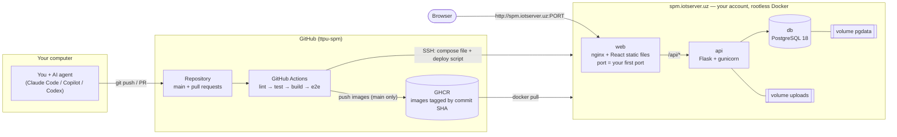
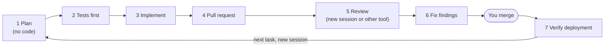

# PromptGram

**Share AI prompts the way you share pictures on Instagram.**
A user writes a prompt, attaches example results, and posts it. Other users scroll the feed, copy the prompt, like it and comment on it.

This is a **template repository** for the SPM course (TTPU, 2026). It contains **no application code**. It contains every decision, requirement and plan that you and your AI coding agent need to build the product, test it and deploy it to your account on the SPM server.

> **Start here:** read this page, then do [docs/STUDENT-GUIDE.md](docs/STUDENT-GUIDE.md) from the top. Section 7 below shows how to prompt your AI agent step by step.
> **AI agents start here:** [AGENTS.md](AGENTS.md).

---

## 1. What you will build

| Area | In the first release (v1.0) |
|---|---|
| Accounts | Register, log in, log out |
| Feed | "Explore" page: all posts, newest first, loads more as you scroll |
| Posts | Create, edit and delete your own prompt post; **copy prompt** button |
| Attachments | Up to 4 files per post (images, PDF, text) |
| Social | Like and unlike a post; comment on a post |
| Profile | A page with one user's posts |
| Operations | Automatic test, build and deployment from GitHub to your server account; data stays after each deployment |

Full list with acceptance criteria: [docs/01-requirements.md](docs/01-requirements.md).

## 2. Architecture

- Only **three containers** run on the server. There is **no source code** on the server: only `compose.yaml`, `deploy.sh`, `.env` and backups in `~/promptgram/`.
- Only the `web` container has a public port. `api` and `db` are reachable only inside the Docker network.
- Data lives in two named volumes. A deployment replaces containers, never volumes.
- The SPM server is the course's shared **test server**. Every student has an own account, home folder, Docker daemon and port range, so all students run their apps side by side. For your project it plays the role that a production server plays in a company. The GitHub environment is therefore named `production`.

Details: [docs/02-architecture.md](docs/02-architecture.md).

## 3. Technology choices

Each choice has a full record (context, alternatives, consequences) in [docs/10-decisions.md](docs/10-decisions.md).

The exact versions are in [docs/02-architecture.md](docs/02-architecture.md) section 10. They were checked against the official registries on 2026-11-14 and tried together in a test run (Python 3.14 with PostgreSQL 18, Node.js 26, the three container images). Use these versions. Many are newer than what AI tools remember; section 10 lists the known traps.

| Place | Choice | Why this one |
|---|---|---|
| Frontend | **React 19 + TypeScript 6 + Vite 8** | Asked for in the brief. TypeScript gives the AI agent and you fast feedback on mistakes. Vite is the standard React build tool. |
| Frontend data | **TanStack Query 5**, **React Router 8** | Server state (cache, loading, errors, infinite scroll) without hand-written code. Standard routing. |
| Styling | **Tailwind CSS 4** | No design system to maintain. AI agents write it well. |
| Backend | **Python 3.14 + Flask 3.1** | Asked for in the brief. Small, explicit, easy to read and review. |
| Backend data | **SQLAlchemy 2.1 + Alembic (Flask-Migrate)**, **psycopg 3** | Schema changes are versioned migration files, applied by the pipeline. |
| Validation | **Pydantic 2** | One schema per request and response. Clear error messages. |
| Auth | **Flask-Login session cookie + CSRF token (Flask-WTF)**, passwords hashed with **scrypt** (Werkzeug) | Cookie is `HttpOnly`, so page scripts cannot steal it. Simpler and safer than JWT in `localStorage`. |
| Database | **PostgreSQL 18** | Asked for in the brief. Version 18 is the current stable major release, supported until November 2030. |
| File storage | **Docker volume on the server**, metadata in PostgreSQL | No extra service. Enough for a class project. |
| App server | **gunicorn 27** (api), **nginx 1.30 unprivileged** (web) | Standard production servers. Both run as non-root. |
| Packaging | **Docker**, multi-stage builds, **Docker Compose** | The server gives each student rootless Docker. One compose file describes the whole stack. |
| Registry | **GitHub Container Registry (GHCR)**, private | Same permissions as the repository. No extra account. |
| CI/CD | **GitHub Actions** with **GitHub-owned actions only** (`actions/*`) + plain shell → GHCR → **SSH** → `docker compose` | Build once, test the image, deploy the same image. No third-party action ever sees a secret. No long-lived token on the server. |
| Backend tools | **uv**, **Ruff**, **pytest 9** | Fast, one lockfile, one linter and formatter. |
| Frontend tools | **Node.js 26 LTS**, **npm**, **ESLint 10 + Prettier**, **Vitest 5 + Testing Library + MSW 3** | Current stable releases that work together. |
| End-to-end tests | **Playwright** | Tests the real images in CI before deployment. |
| Security checks | **Dependabot** (alerts, security updates, version updates); **secret scanning + push protection** and **CodeQL** when the organisation licence allows | All are GitHub's own tools. Nothing to install, results in the Security tab. |
| AI agent rules | **`AGENTS.md`** (one source) + pointers for Claude Code and Copilot | Works with Claude Code, GitHub Copilot and Codex without duplicated rules. |

## 4. Where data lives and how tests stay away from it

| Environment | Where | Database | Who writes to it |
|---|---|---|---|
| **Production** | SPM server, compose project `promptgram` | volume `promptgram_pgdata` | Real users only. The pipeline runs migrations and read-only health checks. |
| **Development** | Your computer, compose project `promptgram-dev` | local volume, database `promptgram` | You, by hand. |
| **Unit and integration tests** | Your computer or GitHub Actions | database `promptgram_test`, emptied by the tests | pytest. The test setup **refuses to start** if the database name does not end in `_test`. |
| **End-to-end tests** | GitHub Actions, compose project `promptgram-e2e` | temporary, deleted after the run | Playwright. |

No test ever connects to the production database. The check after deployment only calls `GET /api/health`.

## 5. GitHub features this project uses

The whole life cycle runs on GitHub's own tools. No third-party CI service, no third-party action.

| Need | GitHub feature |
|---|---|
| Backlog and planning | Issues, issue forms, labels, milestones, Projects board |
| Code review | Pull requests, PR template, Copilot code review (optional) |
| Protect `main` | Repository rulesets with required status checks |
| CI and CD | GitHub Actions on GitHub-hosted runners, GitHub-owned actions only |
| Image registry | GitHub Packages (GHCR) |
| Deployment control and history | Environments (`production`), environment secrets and variables, deployment log |
| Dependency security | Dependency graph, Dependabot alerts, security updates, version updates |
| Code and secret security | CodeQL code scanning, secret scanning, push protection (when licensed for private repositories) |
| Releases | Tags and GitHub Releases |

## 6. What you do in each phase

The complete steps are in [docs/STUDENT-GUIDE.md](docs/STUDENT-GUIDE.md). The plan with tasks and exit criteria is in [docs/09-plan.md](docs/09-plan.md).

| Phase | Result | You (the human) | Your AI agent |
|---|---|---|---|
| **0. Setup** | Repository, access and backlog are ready | Create the repository from this template. Create the deployment SSH key. Create the server `.env` from [`deploy/.env.example`](deploy/.env.example) with your own credentials. Add the `production` environment, its secret and variables. Protect `main` (pull request required). Connect your AI tool. | Creates GitHub issues and the board from the plan. |
| **1. Walking skeleton + CI/CD** | A "hello" page with a health check is live on your port, deployed by the pipeline | Review and merge PRs. Add the required checks to the `main` ruleset after the first green pipeline. Open your URL. | Scaffolds backend, frontend, Docker files, workflows, deploy script. |
| **2. Authentication** | Register, log in, log out | Review PRs. Test in the browser. | Implements with tests. |
| **3. Posts and feed** | Create, read, edit, delete posts; explore feed; profile; copy prompt | Same | Same |
| **4. Attachments** | Upload and show files | Same | Same |
| **5. Likes and comments** | Like, unlike, comment | Same | Same |
| **6. Hardening and release** | v1.0.0, restore drill done, demo ready | Do the backup restore drill. Tag the release. Present. | Security review, fixes, documentation. |

## 7. How to work with your AI agent: the prompt cycle

Do **not** type "implement the backend" or "build issue 14" and wait. That gives you a large change that nobody checked on the way.

Work in small, complete cycles. One cycle = one task = one issue = one pull request. Each cycle uses the **same seven prompts in the same order**. After each prompt there is a checkpoint where you decide. Then you repeat the cycle for the next task. This is iterative development with an AI agent: about 35 short cycles build the whole product, and after every cycle the product is live and working.

Example for one task (issue #14, task P3-T2 "Posts API: create, get, list"). These are short forms. The complete prompts to copy are in [docs/prompts.md](docs/prompts.md), Part A.

| # | You send | The agent does | Your checkpoint |
|---|---|---|---|
| 1 | *"We work on issue #14 (P3-T2). Do not write code yet. Read AGENTS.md, the issue and the documents it names. Give me a plan: files, tests per acceptance criterion, open questions. Wait for my approval."* | Reads the specification. Lists files, tests and questions. | Read the plan. Answer the questions. Approve or correct. |
| 2 | *"The plan is approved. Create the branch. Write the tests from the plan, not the implementation. Run them and show me that they fail because the feature is missing."* | Writes failing tests named after the acceptance criteria. | Read the tests. Do they check what the requirements say? |
| 3 | *"The tests are right. Write the implementation. Do not change a test to make it pass. Run make check until it is green and show me the output."* | Writes the code. Runs lint and all tests. | See the green output. Try it in the browser (`make dev`). |
| 4 | *"Prepare the pull request: clean your diff, update docs/STATUS.md, push, open the PR with the template. Do not merge."* | Opens the PR. CI starts. | The PR exists. |
| 5 | In a **new session or another AI tool**: *"Review pull request #27 as a strict senior reviewer. You did not write this code. Check tests, API contract, security, scope, quality, docs. Report findings with severity. Do not change code."* | Reports findings. | Read the findings **and** the diff. Decide what to fix. |
| 6 | *"Fix these review findings on PR #27: … Add a test first where one was missing. Run make check. Push."* | Fixes and pushes. | CI is green. **You squash-merge.** |
| 7 | *"I merged PR #27, commit abc123. Watch the pipeline with gh. Confirm that /api/health on the server shows this commit. Tell me which task is next."* | Watches the deployment. Names the next task. | Use the feature on the live URL. Close the issue. |

Then open a new session and send prompt 1 for the next issue.

Around the cycles there is one prompt at the start of each phase ("Start of phase") and one at its end ("End of phase check"). For problems there are prompts too: failing pipeline, bug, production problem, agent stuck. All are in [docs/prompts.md](docs/prompts.md).

Why the order matters:

| Rule | Reason |
|---|---|
| Plan before code | Correcting a plan takes one minute. Correcting code takes an hour. |
| Tests before implementation | The tests come from the requirements, not from the code. They cannot "agree" with a wrong implementation. |
| One task per session | Long sessions forget rules and mix up tasks. A new session starts clean and reads the documents again. |
| Review in a new session or another tool | A session tends to defend its own work. Fresh eyes find more. |
| You merge, never the agent | You answer for every line on `main`. |
| Verify on the server | "Done" means live and working, not "the agent said so". |

More about the method: [docs/08-ai-sdlc.md](docs/08-ai-sdlc.md).

## 8. Documents

| File | Content |
|---|---|
| [AGENTS.md](AGENTS.md) | Rules and commands for every AI agent. `CLAUDE.md` and `.github/copilot-instructions.md` point to it. |
| [docs/STUDENT-GUIDE.md](docs/STUDENT-GUIDE.md) | Manual steps for students, phase by phase |
| [docs/00-plan-review.md](docs/00-plan-review.md) | Review of the first rough plan and what changed |
| [docs/01-requirements.md](docs/01-requirements.md) | User stories, acceptance criteria, non-functional requirements, scope |
| [docs/02-architecture.md](docs/02-architecture.md) | Containers, repository layout, configuration, runtime rules |
| [docs/03-data-model.md](docs/03-data-model.md) | Tables, constraints, migration rules |
| [docs/04-api.md](docs/04-api.md) | REST API contract |
| [docs/05-cicd-and-deployment.md](docs/05-cicd-and-deployment.md) | Pipeline, deploy script, rollback, backup and restore |
| [docs/06-testing.md](docs/06-testing.md) | Test levels, data isolation, coverage |
| [docs/07-security.md](docs/07-security.md) | Security rules and known limits |
| [docs/08-ai-sdlc.md](docs/08-ai-sdlc.md) | How to work with an AI agent in this project |
| [docs/09-plan.md](docs/09-plan.md) | Phases, tasks, exit criteria |
| [docs/10-decisions.md](docs/10-decisions.md) | Decision log |
| [deploy/.env.example](deploy/.env.example) | Template of the server `.env` file. Copy it to the server and put in your own credentials. |
| [docs/prompts.md](docs/prompts.md) | The task-cycle prompts (1–7), the phase prompts and the problem prompts |
| [docs/STATUS.md](docs/STATUS.md) | Progress tracker. The agent updates it in every PR. |
| [docs/TEACHER-GUIDE.md](docs/TEACHER-GUIDE.md) | Notes for the teacher: distribution, server facts, checks |
