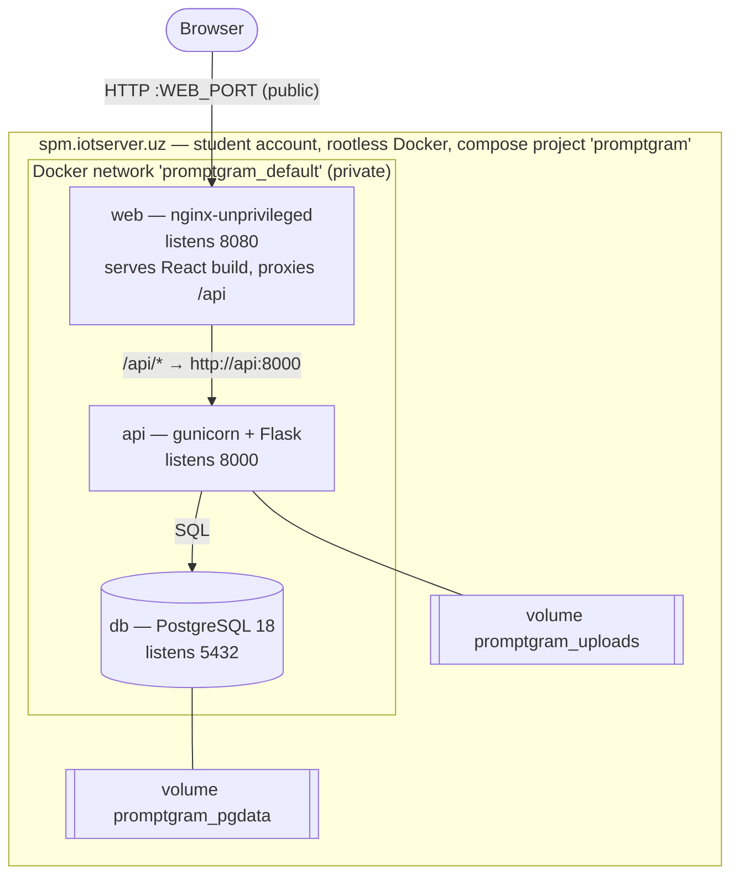

# 02 — Architecture

## 1. Overview

PromptGram is a single-page app (SPA) with a REST API and a relational database. Three containers run under one student's rootless Docker on `spm.iotserver.uz`.

`spm.iotserver.uz` is the course's shared **test server**. Each student has an own account, home folder, Docker daemon and port range, so all students deploy and run in parallel without touching each other. In this project your deployment there is called **production**: it is the live instance with the data that must not be lost.



Request path:

1. The browser loads the React app from `web` (static files, cached by hash).
2. The React app calls `/api/v1/...` on the **same origin**. nginx forwards these calls to `api`. There is no CORS.
3. `api` reads and writes PostgreSQL. It stores uploaded files in the `uploads` volume and serves them back through `/api/v1/media/...` after a login check.

## 2. Containers (production)

| Service | Image | Published port | Volumes | Memory / CPU limit | Health check |
|---|---|---|---|---|---|
| `web` | `ghcr.io/<owner>/<repo>/web:<sha>` — built from `nginxinc/nginx-unprivileged:stable-alpine` + React build | `${WEB_PORT}:8080` | none | 64 MB / 0.25 | `GET http://127.0.0.1:8080/healthz` (answered by nginx itself) |
| `api` | `ghcr.io/<owner>/<repo>/api:<sha>` — built from `python:3.14-slim` | none | `uploads:/data/uploads` | 256 MB / 0.75 | `GET http://127.0.0.1:8000/api/health` |
| `db` | `postgres:18-alpine` (official image, pinned by digest) | none | `pgdata:/var/lib/postgresql` (**not** `…/data`, see section 10) | 256 MB / 0.75 | `pg_isready -U $POSTGRES_USER -d $POSTGRES_DB` |

Rules for all services in `deploy/compose.yaml`:

- `restart: unless-stopped`.
- `logging`: driver `json-file`, `max-size: 10m`, `max-file: 3`.
- `security_opt: ["no-new-privileges:true"]`, `cap_drop: ["ALL"]` for `web` and `api`.
- `web` and `api` run as a non-root user and with `read_only: true`. Writable paths are `tmpfs` (`/tmp`) and the uploads volume.
- `api` starts only when `db` is healthy (`depends_on` with `condition: service_healthy`). `web` starts only when `api` is healthy.
- Compose project name is fixed: `name: promptgram`. Volume names become `promptgram_pgdata` and `promptgram_uploads`.
- `owner` and `repo` in image names are **lower case** (GHCR requires it).

`api` runtime: `gunicorn "app:create_app()"` with **1 worker, 8 threads** (`gthread`), bind `0.0.0.0:8000`, timeout 30 s, `--worker-tmp-dir /tmp`, `--no-control-socket`, access log off (the app writes its own JSON request log). One worker is enough for a class and uses about half the memory of two (measured: 96 MiB against 175 MiB at idle).

`api` image: the Dockerfile creates `/data/uploads` and gives it to the app user **before** `USER`. A new named volume takes its owner from that folder. Without this step the app cannot write uploads.

Health check commands: the `python:3.14-slim` image has no `curl`; use `python -c "import urllib.request; urllib.request.urlopen('http://127.0.0.1:8000/api/health', timeout=3)"`. The nginx alpine image has BusyBox `wget`.

`web` nginx rules:

- `location /api/` → `proxy_pass http://api:8000;` with `X-Forwarded-For`, `X-Forwarded-Proto`, `Host`.
- `client_max_body_size 6m;` (5 MB file + form overhead).
- `location /assets/` → `Cache-Control: public, max-age=31536000, immutable`.
- `location /` → `try_files $uri /index.html;` with `Cache-Control: no-cache` for `index.html`.
- `location = /healthz` → `return 200 "ok";`
- Security headers on every response (list in 07-security). Put them in the `server` block and add `add_header_inherit merge;` there. Without it, any `location` that has its own `add_header` (for example `Cache-Control`) silently drops all headers of the `server` block.
- The container runs with a read-only root file system and a `tmpfs` on `/tmp` (the unprivileged image keeps its pid file and temporary files there). The start-up message "can not modify /etc/nginx/conf.d/default.conf (read-only file system?)" is harmless.
- gzip on for text types.

## 3. Ports

Each student has a range of 50 ports. `PORT_BASE` is the first port of the range (for example `11000`).

| Port | Use |
|---|---|
| `PORT_BASE` | **Production** `web` (public). This is `WEB_PORT`. |
| `PORT_BASE + 1` … `+ 9` | Reserved for later use (for example a staging stack). |
| `PORT_BASE + 10` … `+ 49` | Free for other course work. |

Development and tests run on your own computer or on GitHub runners, not on the server. Default local ports: web `5173`, api `8000`, db `5432`.

## 4. Repository layout (created in Phase 1)

```
.
├── AGENTS.md  CLAUDE.md  README.md  Makefile
├── compose.dev.yaml            # dev: db + api (reload) + web (Vite)
├── compose.e2e.yaml            # e2e: built images + temporary db
├── .github/
│   ├── workflows/ci.yml        # checks, build, scan, e2e, push, call deploy
│   ├── workflows/deploy.yml    # reusable + manual deploy / rollback
│   ├── dependabot.yml
│   └── (templates, copilot-instructions.md)
├── backend/
│   ├── AGENTS.md               # backend-only conventions
│   ├── Dockerfile              # multi-stage, non-root, final image has no build tools
│   ├── pyproject.toml  uv.lock
│   ├── app/
│   │   ├── __init__.py         # create_app()
│   │   ├── config.py           # reads environment variables
│   │   ├── extensions.py       # db, migrate, login_manager, csrf, limiter
│   │   ├── errors.py           # typed exceptions + one JSON error handler
│   │   ├── logging.py          # JSON request log
│   │   ├── models/             # user.py, post.py, attachment.py, like.py, comment.py
│   │   ├── schemas/            # Pydantic request/response models
│   │   ├── services/           # business rules, storage.py for files
│   │   └── api/                # blueprints: health, auth, posts, attachments, likes, comments, users, media
│   ├── migrations/             # Alembic
│   └── tests/                  # conftest.py (with the _test guard), unit/, integration/
├── frontend/
│   ├── AGENTS.md               # frontend-only conventions
│   ├── Dockerfile              # stage 1: node build; stage 2: nginx-unprivileged
│   ├── nginx.conf
│   ├── package.json  package-lock.json  vite.config.ts  tsconfig.json  eslint.config.js
│   ├── src/
│   │   ├── main.tsx  App.tsx  routes.tsx
│   │   ├── api/                # client.ts (fetch wrapper with CSRF), one file per resource, types.ts
│   │   ├── pages/              # LoginPage, RegisterPage, FeedPage, PostDetailPage, PostFormPage, ProfilePage, NotFoundPage
│   │   ├── components/         # PostCard, LikeButton, CommentList, FileInput, Header, ...
│   │   ├── hooks/              # useAuth, useInfiniteFeed, ...
│   │   └── lib/                # time formatting, clipboard
│   └── e2e/                    # Playwright tests + playwright.config.ts
├── deploy/
│   ├── compose.yaml            # production stack (the only compose file that goes to the server)
│   ├── deploy.sh               # runs on the server, called by the pipeline
│   ├── backup.sh  restore.sh
│   └── .env.example            # template of the server .env (already in the template repository)
└── docs/
```

## 5. Frontend routes

| Route | Page | Access |
|---|---|---|
| `/login` | Log in | Visitor (members are redirected to `/`) |
| `/register` | Register | Visitor |
| `/` | Explore feed | Member |
| `/posts/new` | Create post | Member |
| `/posts/:id` | Post detail | Member |
| `/posts/:id/edit` | Edit post | Author |
| `/u/:username` | Profile | Member |
| `*` | Not found | All |

A route guard asks `GET /api/v1/auth/me` once at start. On 401 it sends the visitor to `/login?next=<path>`.

## 6. Configuration

All settings are environment variables. The same image runs everywhere.

### 6.1 `api` container

| Variable | Example | Meaning |
|---|---|---|
| `APP_ENV` | `production` \| `development` \| `test` | Selects the config class. |
| `DATABASE_URL` | `postgresql+psycopg://promptgram:***@db:5432/promptgram` | SQLAlchemy URL. Built in the compose file from the `POSTGRES_*` values. |
| `SECRET_KEY` | 64 random hex characters | Signs the session cookie and CSRF token. No default in production: the app refuses to start without it. |
| `SESSION_COOKIE_NAME` | `pg_session_11000` | Unique per deployment (cookies are shared between ports of one host). Compose sets it to `pg_session_${WEB_PORT}`. |
| `SESSION_COOKIE_SECURE` | `false` | `false` on the course server (HTTP). Set `true` when HTTPS exists. |
| `UPLOAD_DIR` | `/data/uploads` | Where files are stored. |
| `MAX_UPLOAD_MB` | `5` | Per-file limit. |
| `LOG_LEVEL` | `INFO` | |
| `APP_VERSION` | commit SHA | **Baked into the image** at build time (`ARG APP_VERSION` → `ENV`). Returned by `/api/health`. Not set at runtime. |

### 6.2 Server file `~/promptgram/.env`

The student creates this file **once**, by hand, from the template [`deploy/.env.example`](../deploy/.env.example) (STUDENT-GUIDE step 0.5). The student chooses the credentials. Mode `600`. The real file is never in git, never in GitHub, never on a developer machine.

| Variable | Set by | Meaning |
|---|---|---|
| `POSTGRES_USER` | student (default `promptgram`) | Database user |
| `POSTGRES_DB` | student (default `promptgram`) | Database name |
| `POSTGRES_PASSWORD` | student, for example `openssl rand -hex 24` | Letters and digits only. PostgreSQL applies it only when the database is first created. |
| `SECRET_KEY` | student, for example `openssl rand -hex 32` | At least 32 characters |
| `SESSION_COOKIE_SECURE` | student (default `false`) | See 6.1 |
| `MAX_UPLOAD_MB` | student (default `5`) | See 6.1 |
| `LOG_LEVEL` | student (default `INFO`) | See 6.1 |
| `IMAGE_REPO` | pipeline, every deployment | `ghcr.io/<owner>/<repo>` in lower case |
| `IMAGE_TAG` | pipeline, every deployment | Commit SHA (40 characters) |
| `WEB_PORT` | pipeline, every deployment | `PORT_BASE`, from the GitHub variable `DEPLOY_PORT_WEB` |

Rules:

- `deploy.sh` changes only the three pipeline lines. It never creates the file and never changes a student value.
- `deploy.sh` stops with a clear message when the file is missing, when a required value is empty, or when a value is still `CHANGE_ME`.
- `deploy/compose.yaml` passes the values to the containers. `DATABASE_URL` is built there from the `POSTGRES_*` values.
- The template and this table must list the same variables. A PR that adds a variable changes both, and tells the student in the PR text to add the line on the server **before** the merge.

### 6.3 GitHub (environment `production`)

| Name | Kind | Value |
|---|---|---|
| `DEPLOY_SSH_KEY` | secret | Private key of the deployment key pair |
| `DEPLOY_HOST` | variable | `spm.iotserver.uz` |
| `DEPLOY_USER` | variable | Your login on the server |
| `DEPLOY_PORT_WEB` | variable | Your `PORT_BASE` |
| `DEPLOY_KNOWN_HOSTS` | variable | The server's SSH host key line (in STUDENT-GUIDE) |

### 6.4 Local development file `.env` (git-ignored)

`compose.dev.yaml` works without any `.env` file. It has safe development defaults (`POSTGRES_PASSWORD=dev`, `SECRET_KEY=dev-not-secret`). A `.env.example` at the repository root (created in Phase 1) documents optional overrides such as ports. Do not mix it up with `deploy/.env.example`, which is the template for the server.

## 7. Data and storage

- Database tables: [03-data-model.md](03-data-model.md).
- Files: `UPLOAD_DIR/<yyyy>/<mm>/<random 32 hex>.<ext>`. The random name is created by the server. The original file name is stored only in the database.
- When a post or attachment is deleted, the API deletes the file after the database commit succeeds.
- Backups: `deploy.sh` makes a compressed `pg_dump` before each deployment and keeps the last 5 in `~/promptgram/backups/`. Uploads are backed up by `deploy/backup.sh` on request. See 05.

## 8. Runtime rules

- **Stateless containers.** `api` and `web` keep no state in the container file system. They can be replaced at any time.
- **Migrations** run as a separate step before the new `api` starts: `docker compose run --rm api flask db upgrade`. The `api` container does **not** migrate at start (two workers would race).
- **Backward-compatible migrations.** A new migration must work with the previous release of the code. This makes automatic rollback of the containers safe. Rules in 03.
- **Short downtime is accepted.** A deployment recreates `api` and `web` (a few seconds). Zero-downtime deployment is not a goal.
- **Time** is stored in UTC (`timestamptz`). The API returns ISO 8601 with `Z`. The browser shows relative time.

## 9. What is intentionally not here

| Not used | Reason |
|---|---|
| Kubernetes, Swarm | One host, three containers. Compose is enough. |
| Redis, message queue, background workers | No feature needs them in v1.0. |
| Object storage (MinIO, S3) | A volume is enough for class-size data and saves disk and memory. |
| Separate staging stack on the server | Disk and RAM are shared by all students. The e2e stack in CI plays this role. |
| Server-side rendering | The app is behind a login. No SEO need. |
| Self-hosted GitHub runner on the server | It would use the 2 shared CPUs and the 3 GB quota, and it keeps a privileged agent on the server. |

## 10. Version baseline

Checked on **2026-11-14** against PyPI, npm, Docker Hub, endoflife.date and the GitHub release pages. "Use" is the constraint for `pyproject.toml`, `package.json`, Dockerfiles and workflows. The lockfiles record the exact versions. Dependabot moves them later.

### 10.1 Runtimes and images

| Component | Use | Newest at the check | Why this one |
|---|---|---|---|
| Python | **3.14** — image `python:3.14-slim` | 3.14.10 (3.15.2 also exists) | 3.14 is one year old, gets bug fixes until October 2027, and every package below supports it. 3.15 is five weeks old. |
| Node.js | **26 LTS** — image `node:26-alpine` | 26.13.1 | Active LTS since 2026-10-28. Node 24 is in maintenance. Only the build and test steps use Node; no Node runs on the server. |
| PostgreSQL | **18** — image `postgres:18-alpine` | 18.7 | Newest major release, 14 months old, supported until November 2030. |
| nginx | **stable (1.30)** — image `nginxinc/nginx-unprivileged:stable-alpine` | 1.30.6 | Stable branch, runs as non-root. |
| Docker on the SPM server | Engine 29.9, Compose v5.6 | — | Installed by the teacher. |
| Docker on GitHub runners | `runs-on: ubuntu-24.04` (same as `ubuntu-latest`): Engine 28.0, Compose v2.38 | — | Use only Compose features that both versions have (`up --wait`, `--wait-timeout`, `depends_on.condition`, `name:`). |
| GitHub actions | `actions/checkout` **v7**, `actions/setup-python` **v7**, `actions/setup-node` **v7**, `actions/cache` **v6**, `actions/upload-artifact` **v7** | same | Pin each to the commit SHA of its newest release in that major version. |

### 10.2 Backend packages (`backend/pyproject.toml`)

| Package | Use | Newest at the check |
|---|---|---|
| flask | `>=3.1,<3.2` | 3.1.3 |
| sqlalchemy | `>=2.1,<2.2` | 2.1.8 |
| flask-sqlalchemy | `>=3.1,<3.2` | 3.1.1 |
| flask-migrate (with alembic) | `>=4.1,<5` | 4.1.0 (alembic 1.20.1) |
| psycopg[binary] | `>=3.3,<3.4` | 3.3.9 |
| pydantic | `>=2.14,<3` | 2.14.3 |
| gunicorn | `>=27,<28` | 27.0.1 |
| flask-login | `>=0.6.3,<0.7` | 0.6.3 |
| flask-wtf | `>=1.3,<1.4` | 1.3.0 |
| flask-limiter | `>=4.1,<5` | 4.1.1 |
| pytest (dev) | `>=9.2,<10` | 9.2.0 |
| pytest-cov (dev) | `>=7.1,<8` | 7.1.0 |
| ruff (dev) | `>=0.17,<0.18` | 0.17.5 |
| uv (tool, in CI and Dockerfile) | `==0.13.8` | 0.13.8 |

`requires-python = ">=3.14,<3.15"`. Werkzeug (3.1.9) comes with Flask; do not pin it yourself.

### 10.3 Frontend packages (`frontend/package.json`)

| Package | Use | Newest at the check |
|---|---|---|
| react, react-dom | `^19.3.1` | 19.3.1 |
| react-router | `^8.5.1` | 8.5.1 |
| @tanstack/react-query | `^5.107.1` | 5.107.1 |
| vite | `^8.3.8` | 8.3.8 |
| @vitejs/plugin-react | `^6.3.0` | 6.3.0 |
| **typescript** | **`~6.0.3`** | 7.0.2 — **do not use 7 yet**, see trap 2 |
| tailwindcss, @tailwindcss/vite | `^4.3.5` | 4.3.5 |
| vitest, @vitest/coverage-v8 | `^5.1.0` | 5.1.0 |
| jsdom | `^31.0.1` | 31.0.1 |
| @testing-library/react | `^16.3.3` | 16.3.3 |
| @testing-library/dom | `^10.4.0` | 10.4.2 |
| @testing-library/user-event | `^14.6.10` | 14.6.10 |
| @testing-library/jest-dom | `^7.0.1` | 7.0.1 |
| msw | `^3.0.5` | 3.0.5 |
| @playwright/test | `^1.65.1` | 1.65.1 |
| @axe-core/playwright | `^4.14.0` | 4.14.0 |
| eslint, @eslint/js | `^10.15.0`, `^10.0.0` | 10.15.0, 10.0.1 |
| typescript-eslint | `^8.72.2` | 8.72.2 |
| eslint-plugin-react-hooks | `^7.1.1` | 7.1.1 |
| prettier | `^3.10.1` | 3.10.1 |
| @types/react, @types/react-dom, @types/node | `^19.2.0`, `^19.2.0`, `^24.0.0` | 19.3.0, 19.3.0, 24.19.2 |

`"engines": { "node": ">=26" }`. The npm that comes with Node 26.13 is 11.20.

### 10.4 What the check covered

A small test run on a GitHub-hosted runner (`ubuntu-24.04`) on 2026-11-14 used exactly these versions. All steps passed:

- **Backend, Python 3.14.10 + PostgreSQL 18.7:** install with uv; Ruff; pytest with coverage on a real database (session login with Flask-Login, CSRF header with Flask-WTF, rate limit with Flask-Limiter, validation with Pydantic, typed SQLAlchemy 2.1 model); the `_test` database guard; Alembic migrate, upgrade, downgrade, upgrade, check; gunicorn serving the app.
- **Frontend, Node.js 26.13.1:** install; ESLint 10 with typescript-eslint; Prettier; TypeScript 6.0.3 strict; Vitest 5 with Testing Library, jsdom and MSW 3; Vite 8 production build with Tailwind 4, React Router 8 and TanStack Query 5.
- **Containers:** images built with the plain Docker CLI (api **164 MB**, web **60 MB**; `postgres:18-alpine` is 304 MB); stack started with `docker compose up --wait` and health checks; non-root users, read-only root file systems, dropped capabilities; register through nginx with session cookie and CSRF token; **data still there after all containers were removed and created again**; no anonymous volumes; Playwright 1.65 and axe against the running stack. Idle memory: api 96 MiB, db 26 MiB, web 4 MiB.

Not covered by the check: the rootless Docker daemon of the SPM server, the complete application, and load. The test code was thrown away. It is not in this repository; students write the real code.

### 10.5 Known traps with these versions

AI tools often write code for older versions. These points were found or confirmed in the check.

1. **PostgreSQL 18 volume path.** Mount the volume at `/var/lib/postgresql`. The data directory is `/var/lib/postgresql/18/docker`. The old path `/var/lib/postgresql/data` (correct up to version 17) makes the container stop at start with "Error: in 18+, these Docker images are configured to store database data in a format which is compatible with pg_ctlcluster".
2. **TypeScript 7 is not usable yet.** `typescript-eslint` 8.72 supports TypeScript `<6.1`. Keep `typescript` at `~6.0.3`. Add a Dependabot `ignore` rule for TypeScript major updates. Remove it when `typescript-eslint` supports version 7.
3. **TypeScript 6 and CSS imports.** `import "./index.css"` fails with TS2882 unless `tsconfig.json` has `"types": ["vite/client"]` (plus `"node"` if you set `types`).
4. **MSW 3.** The option for unknown requests is `server.listen({ onUnhandledFrame: "error" })`. The MSW 2 name `onUnhandledRequest` is a type error. `http`, `HttpResponse` (from `msw`) and `setupServer` (from `msw/node`) are unchanged.
5. **gunicorn 27 control socket.** With a read-only root file system gunicorn logs "Control server error: Read-only file system". Start it with `--no-control-socket`.
6. **nginx header inheritance.** See section 2: `add_header_inherit merge;` (nginx 1.29.3 or newer).
7. **Uploads volume owner.** See section 2: create `/data/uploads` with the app user as owner in the image.
8. **React Router 8.** Import everything from `react-router` (`BrowserRouter`, `MemoryRouter`, `Routes`, `Route`, `Link`). You do not need the `react-router-dom` package. Version 8 needs Node 22.22 or newer and React 19.2.7 or newer.
9. **ESLint 10.** Flat config only (`eslint.config.js`). Use `defineConfig` and `globalIgnores` from `eslint/config`, `js.configs.recommended` from `@eslint/js`, and `tseslint.configs.recommended` from `typescript-eslint`.
10. **Tailwind 4.** No `tailwind.config.js` and no PostCSS setup. Add the `@tailwindcss/vite` plugin and write `@import "tailwindcss";` in the CSS file.
11. **Vitest 5.** Configure it in `vite.config.ts` with `defineConfig` from `vitest/config`. Use `@testing-library/jest-dom/vitest` in the setup file.
12. **Older but working packages.** `flask-login` 0.6.3 and `flask-sqlalchemy` 3.1.1 had their last release in 2023. They work with Flask 3.1.3, SQLAlchemy 2.1.8 and Python 3.14 (confirmed in the check). Do not replace them.
