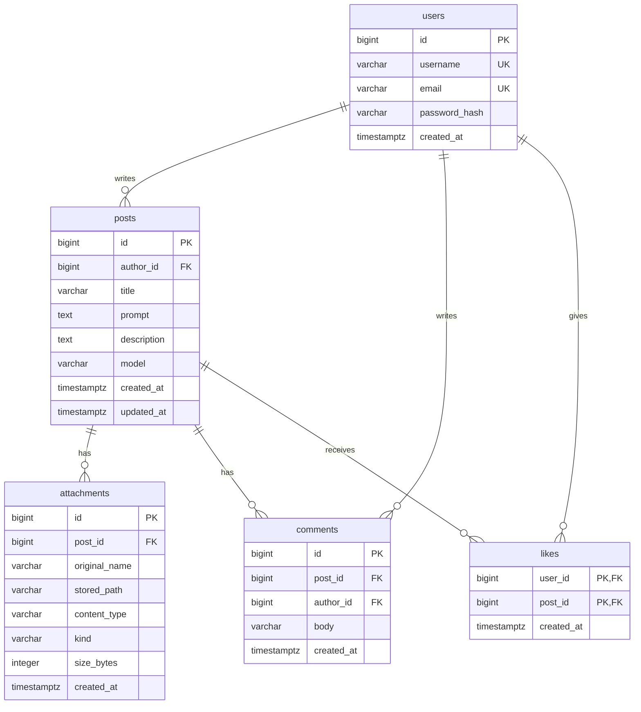

# 03 — Data model

Database: PostgreSQL 18. ORM: SQLAlchemy 2.1 (typed models). Migrations: Alembic through Flask-Migrate.

## 1. Diagram

## 2. Tables

General rules: primary keys are `bigint generated always as identity`. Time columns are `timestamptz`, default `now()`, stored in UTC. Text lengths are enforced by a `CHECK` or `varchar(n)` **and** by the API validation.

### `users`

| Column | Type | Rules |
|---|---|---|
| `id` | bigint | PK |
| `username` | varchar(30) | not null, unique, lower case, matches `^[a-z0-9_]{3,30}$` (CHECK) |
| `email` | varchar(254) | not null, unique, lower case |
| `password_hash` | varchar(255) | not null. Werkzeug `generate_password_hash` (scrypt). |
| `created_at` | timestamptz | not null |

The API converts username and email to lower case before it stores or compares them.

### `posts`

| Column | Type | Rules |
|---|---|---|
| `id` | bigint | PK |
| `author_id` | bigint | not null, FK → `users.id` `ON DELETE CASCADE` |
| `title` | varchar(120) | not null, length ≥ 3 |
| `prompt` | text | not null, length 10–8000 (CHECK) |
| `description` | text | null, length ≤ 2000 (CHECK) |
| `model` | varchar(60) | null |
| `created_at` | timestamptz | not null |
| `updated_at` | timestamptz | not null. Changes on edit. `edited = updated_at > created_at`. |

Indexes: `(created_at DESC, id DESC)` for the feed; `(author_id, created_at DESC, id DESC)` for profiles.

### `attachments`

| Column | Type | Rules |
|---|---|---|
| `id` | bigint | PK |
| `post_id` | bigint | not null, FK → `posts.id` `ON DELETE CASCADE`, indexed |
| `original_name` | varchar(255) | not null. Shown to users. Never used as a path. |
| `stored_path` | varchar(100) | not null, unique. Relative to `UPLOAD_DIR`, for example `2026/11/3f…a9.png`. |
| `content_type` | varchar(100) | not null. Decided by the server from the allow-list. |
| `kind` | varchar(10) | not null, `image` or `file` (CHECK) |
| `size_bytes` | integer | not null, 1 … 5 242 880 |
| `created_at` | timestamptz | not null |

At most 4 attachments per post. The service layer enforces this inside the transaction that inserts the row (lock the post row with `SELECT … FOR UPDATE`, then count).

### `likes`

| Column | Type | Rules |
|---|---|---|
| `user_id` | bigint | FK → `users.id` `ON DELETE CASCADE` |
| `post_id` | bigint | FK → `posts.id` `ON DELETE CASCADE` |
| `created_at` | timestamptz | not null |

Primary key `(user_id, post_id)`: one like per user per post. Extra index on `post_id` for counts.
Insert with `ON CONFLICT DO NOTHING` so that a repeated request is harmless.

### `comments`

| Column | Type | Rules |
|---|---|---|
| `id` | bigint | PK |
| `post_id` | bigint | not null, FK → `posts.id` `ON DELETE CASCADE` |
| `author_id` | bigint | not null, FK → `users.id` `ON DELETE CASCADE` |
| `body` | varchar(1000) | not null, length ≥ 1 after trim |
| `created_at` | timestamptz | not null |

Index: `(post_id, created_at, id)`.

## 3. Counts

`like_count` and `comment_count` are **not** stored columns. The list query computes them with correlated sub-queries (or grouped joins). At class scale this meets NFR-06 and avoids counter bugs. If the timing check in Phase 6 fails, add counter columns with a decision record.

The feed query must not cause N+1 queries: one query for the page of posts with counts and `liked_by_me`, one query for their attachments, authors loaded by join.

## 4. Sessions

There is no session table. Flask stores the session in a signed cookie. Logout clears the cookie. This is enough for v1.0 (limit L-3 in 07 explains what it cannot do).

## 5. Migration rules

1. Every schema change is an Alembic migration in `backend/migrations/versions/`, created with `make migration m="..."` and then **read and corrected by hand**. Auto-generated migrations miss CHECK constraints and some index changes.
2. Never edit a migration that is merged to `main`. Add a new one.
3. Each migration has a working `downgrade()`. CI runs upgrade → downgrade → upgrade on an empty database.
4. CI fails when models and migrations differ (`flask db check`).
5. **Backward compatible (expand, then contract).** The previous release of the code must still run after the migration:
   - Add a column as nullable or with a default. Do not add `NOT NULL` without a default in one step.
   - Do not rename or drop a column that the previous release reads. First release code that stops using it. Drop it in a later release.
6. Migrations must be fast (seconds). No long data rewrites inside a deployment.
7. Seed or demo data is never part of a migration. A separate command `flask seed-demo` exists for development and refuses to run when `APP_ENV=production`.
