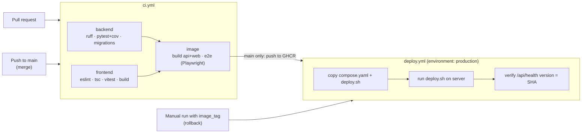

# 05 — CI/CD and deployment

Goal: every merge to `main` that passes all checks reaches the server automatically, safely and repeatably. Nobody deploys by hand.

## 1. Principles

1. **Build once.** CI builds the images one time. The same images are tested end to end, pushed, and deployed.
2. **Immutable tags.** Images are tagged with the full commit SHA. The server never runs `latest`.
3. **Gate before deploy.** Lint, tests, image build and e2e must pass first.
4. **GitHub's own tools only.** GitHub-hosted runners, GitHub-owned actions, GitHub Packages, GitHub environments, GitHub security features. No third-party action or service.
5. **Health-gated rollout.** The deploy script waits for healthy containers. If they do not become healthy, it starts the previous release again and fails the job.
6. **Data is never replaced.** A deployment touches containers and images. It never touches volumes.
7. **Backup before change.** The script dumps the database before it runs migrations.
8. **No long-lived registry token on the server.** The job passes its short-lived `GITHUB_TOKEN` for the pull. It is logged out afterwards.
9. **No source code on the server.** Only `compose.yaml` and `deploy.sh` are copied.
10. **One deployment at a time.** Workflow concurrency group plus a lock file on the server.
11. **Rollback is a button.** Run the deploy workflow by hand with an older commit SHA.

## 2. Pipeline overview



## 3. Workflow `ci.yml`

**Triggers:** `pull_request` (to `main`), `push` (to `main`).

What starts what:

| Event | What runs |
|---|---|
| You open a pull request to `main`, or push more commits to its branch | `changes`, then the checks `backend`, `frontend`, `image` (build and e2e). Nothing is pushed to the registry. Nothing is deployed. |
| You merge a pull request (this is a push to `main`) | The same checks again on the merged code, then the images go to GHCR, then `deploy` runs. |
| The change touches **only documents** (pull request or merge) | Only `changes`. No build, no deployment. The server keeps its version. |
| You push commits to a branch that has no pull request | Nothing. |
| Someone pushes directly to `main` | GitHub rejects the push (ruleset `protect-main`, STUDENT-GUIDE steps 0.7 and 1.3). |
| You start `deploy` by hand with an `image_tag` | Deployment of that older version (rollback, section 6). |
| You create a tag or a release | Nothing. |
| Dependabot opens a pull request | The same as any pull request. |
**Concurrency:** group `ci-${{ github.ref }}`, `cancel-in-progress: true` for pull requests only.
**Default permissions:** `contents: read`. Jobs add only what they need.
**Runner:** `ubuntu-24.04`. Every job has `timeout-minutes: 15`.

| Job | Needs | Steps | Fails when |
|---|---|---|---|
| `changes` | — | `actions/checkout` with `fetch-depth: 0` → plain shell lists the changed files (pull request: `git diff --name-only origin/$BASE_REF...HEAD`; push: `git diff --name-only $BEFORE_SHA $GITHUB_SHA`) → job output `code`: `true` when at least one changed file is **not** a document. A document is a file under `docs/`, a file under `.github/ISSUE_TEMPLATE/`, or any `*.md` file. On any error, or when `BEFORE_SHA` is all zeros, the output is `true` (fail safe: run everything). | Checkout fails |
| `backend` | `changes`, only `if: needs.changes.outputs.code == 'true'` | `actions/checkout` → `actions/setup-python` (3.14) → `python -m pip install uv==0.13.8` → `actions/cache` for the uv cache (key: hash of `uv.lock`) → `uv sync --frozen` → `ruff check` → `ruff format --check` → migrations: `flask db upgrade`, `flask db downgrade base`, `flask db upgrade`, `flask db check` → `pytest --cov --cov-fail-under=80`. PostgreSQL 18 (`postgres:18-alpine`) runs as a **service container** with database `promptgram_test`. | Lint, format, migration or test error; coverage < 80 % |
| `frontend` | `changes`, same `if` | `actions/checkout` → `actions/setup-node` (Node 26, built-in npm cache) → `npm ci` → `npm run lint` → `npm run typecheck` → `npm test -- --coverage` → `npm run build` | Any error; coverage < 70 % |
| `image` | `backend`, `frontend` | `actions/checkout` → build both images with the Docker CLI that is already on the runner: `docker build --build-arg APP_VERSION=$GITHUB_SHA -t $IMAGE_REPO/api:$GITHUB_SHA backend` and the same for `web` → print the image sizes and fail when api > 250 MB or web > 80 MB → `docker compose -f compose.e2e.yaml up -d --wait` with the built images → Playwright tests → `actions/upload-artifact` for the Playwright report when a test fails → `compose down -v`. **On push to `main` only:** `echo "$GITHUB_TOKEN" \| docker login ghcr.io -u "$GITHUB_ACTOR" --password-stdin`, then `docker push` of both images with tag `$GITHUB_SHA`, then `docker logout ghcr.io`. | Build error; image over its size budget; e2e fails |
| `deploy` | `image` | Only on push to `main`, and only when `image` ran and passed (so never for a documents-only change). Calls `deploy.yml` with `image_tag: ${{ github.sha }}`. | See section 4 |

Permissions: `image` needs `packages: write`. `deploy` needs `packages: read`.

Image names (lower case, computed in the workflow because the repository name can have capitals):

```
IMAGE_REPO = ghcr.io/<owner lower case>/<repository lower case>
api image  = $IMAGE_REPO/api:<sha>
web image  = $IMAGE_REPO/web:<sha>
```

Rules for the workflow files:

- Pin every action to a full commit SHA with the version in a comment (`uses: actions/checkout@<40-hex> # v7.0.1`). The major versions to use are in 02 section 10.1. Dependabot keeps them current.
- **GitHub-owned actions only.** Allowed: `actions/checkout`, `actions/setup-python`, `actions/setup-node`, `actions/cache`, `actions/upload-artifact`. Allowed when the matching feature is on (section 9): `github/codeql-action`, `actions/dependency-review-action`, `actions/attest-build-provenance`. **No third-party action**, also not from verified publishers. Everything else is plain shell: `docker build`, `docker login`, `docker push`, `ssh`, `scp`, `curl`. Decision D-21.
- The repository setting *Allow actions created by GitHub* enforces this rule (STUDENT-GUIDE step 0.7). A workflow that names another action does not start.
- Tools are not actions. Installing a tool inside a job with its normal package manager is allowed (`pip install uv`, `npm ci`, `npx playwright install --with-deps chromium`). Pin the versions.
- No build cache in the first version: both images build in about 2–3 minutes. Dependency caches for the test jobs come from `actions/setup-node` and `actions/cache`.
- No `pull_request_target`. No secrets in jobs that run on pull requests.
- Never write `${{ ... }}` expressions directly inside `run:` scripts when the value comes from a user (branch name, PR title). Pass them through `env:`.
- Required status checks for the `main` ruleset: `changes`, `backend`, `frontend`, `image`. GitHub counts a **skipped** job as passed. So a documents-only pull request can merge, with `backend`, `frontend` and `image` skipped. `changes` must be in the list: if it failed, the other jobs would be skipped and would look passed.

## 4. Workflow `deploy.yml`

**Triggers:** `workflow_call` (from `ci.yml`) and `workflow_dispatch` (manual), both with input `image_tag` (40-character commit SHA).
**Environment:** `production` (holds the secret and variables; deployment branch rule: `main` only).
**Concurrency:** group `deploy-production`, `cancel-in-progress: false`. A running deployment is never cancelled; the next one waits.
**Permissions:** `contents: read`, `packages: read`.

Steps:

1. Check that `image_tag` matches `^[0-9a-f]{40}$`. Stop otherwise.
2. Checkout (the commit of `image_tag`; only `deploy/` is needed).
3. Prepare SSH with plain shell: write `DEPLOY_SSH_KEY` to `~/.ssh/id_ed25519` (mode 600); write `DEPLOY_KNOWN_HOSTS` to `~/.ssh/known_hosts`. **Never** use `StrictHostKeyChecking=no`.
4. `ssh` → `mkdir -p ~/promptgram`. `scp deploy/compose.yaml deploy/deploy.sh` → `~/promptgram/`.
5. Run the script. The registry token goes through **stdin**, never as an argument:
   ```
   printf '%s' "$GITHUB_TOKEN" | ssh "$DEPLOY_USER@$DEPLOY_HOST" \
     "IMAGE_REPO='$IMAGE_REPO' IMAGE_TAG='$IMAGE_TAG' WEB_PORT='$DEPLOY_PORT_WEB' GHCR_USER='$GITHUB_ACTOR' bash ~/promptgram/deploy.sh"
   ```
6. Verify from the runner (outside the server): call `http://$DEPLOY_HOST:$DEPLOY_PORT_WEB/api/health` up to 10 times, 3 s apart. Pass when `status` is `ok` and `version` equals `image_tag`. Then fetch `/` and expect HTTP 200 with the HTML title.
7. Write a job summary: URL, commit, previous release, result.
8. Always remove the key file at the end.

## 5. Server script `deploy/deploy.sh`

Runs on the server as the student. Bash with `set -euo pipefail`. It must be **idempotent**: running it twice with the same input changes nothing the second time.

Inputs: environment variables `IMAGE_REPO`, `IMAGE_TAG`, `WEB_PORT`, `GHCR_USER`; the registry token on stdin.

Behaviour, in order:

1. `cd ~/promptgram`. Take an exclusive lock with `flock` on `.deploy.lock` (wait up to 120 s, then fail).
2. Validate inputs (`IMAGE_TAG` is 40 hex characters, `WEB_PORT` is a number between 1024 and 65535).
3. **Check `.env`.** The student created it from `deploy/.env.example` (02 section 6.2). Stop with exit code 1 and a clear message when: the file is missing; `POSTGRES_USER`, `POSTGRES_DB`, `POSTGRES_PASSWORD` or `SECRET_KEY` is missing or empty; a value is still `CHANGE_ME`; `SECRET_KEY` is shorter than 32 characters. The message names the variable and points to STUDENT-GUIDE step 0.5. It never prints a value. Set the mode to `600` if it is different.
4. Remember the previous release: read `IMAGE_TAG` from `.env` into `PREV_TAG` (empty on the first deployment). Then replace **only** the three lines `IMAGE_REPO=`, `IMAGE_TAG=`, `WEB_PORT=` with the new values (add a line if it is missing). Never change another line.
5. `docker login ghcr.io -u "$GHCR_USER" --password-stdin` (token from stdin). `docker compose pull api web`. `docker logout ghcr.io` (also on failure, with a `trap`). Do not pull `db` here: Compose pulls `postgres` only when it is missing. All students share one server address, and Docker Hub limits anonymous pulls per address.
6. **Backup** (skip on the first deployment): if the `db` container runs, `pg_dump` | `gzip` → `backups/pre-deploy-<UTC timestamp>-<first 7 chars of PREV_TAG>.sql.gz`. Keep the newest 5 pre-deploy backups. Fail the deployment if the dump fails.
7. `docker compose up -d --wait db`.
8. **Migrate:** `docker compose run --rm api flask db upgrade`. On failure go to step 10.
9. **Roll out:** `docker compose up -d --wait --wait-timeout 90 --remove-orphans`. Then call `http://127.0.0.1:$WEB_PORT/api/health` and check that `version` equals `IMAGE_TAG`.
10. **On failure of step 8 or 9:** print the last 50 log lines of `api` and `web`. If `PREV_TAG` is not empty, write it back to `.env` as `IMAGE_TAG` and run `docker compose up -d --wait`. Exit with code 1. (The database stays at the new schema. This is safe because migrations are backward compatible, see 03.)
11. **On success:** append one line to `releases.log` (`timestamp tag`). Run `docker image prune -af` to remove images that no container uses. Print `docker system df` and the disk quota.

Files in `~/promptgram/` on the server:

```
compose.yaml      copied by each deployment
deploy.sh         copied by each deployment
.env              created once by the student from deploy/.env.example (mode 600);
                  the pipeline rewrites only IMAGE_REPO, IMAGE_TAG, WEB_PORT
.deploy.lock      lock file
releases.log      history of successful deployments
backups/          pre-deploy-*.sql.gz (5 newest) and manual backups
```

## 6. Rollback

| Situation | Action |
|---|---|
| New containers do not become healthy | Automatic. The script restarts the previous release and the job fails. Fix forward with a new PR. |
| The release is healthy but has a bug | GitHub → Actions → **deploy** → *Run workflow* → `image_tag` = the last good commit SHA (see `releases.log` or the Actions history). Then fix the bug in a new PR, or revert the bad PR. |
| A migration damaged data | Stop `api` and `web`. Restore the newest good pre-deploy backup with `deploy/restore.sh`. Deploy the matching older `image_tag`. This is the only manual server operation, and it is practised once in Phase 6. |

Old images stay in GHCR, so any earlier commit of `main` can be deployed again.

## 7. Backup and restore

| Script | What it does |
|---|---|
| `deploy/backup.sh` | Manual full backup: `pg_dump` (gzip) + a `tar.gz` of the uploads volume → `backups/manual-<timestamp>/`. Prints the sizes. |
| `deploy/restore.sh <backup>` | Asks for the word `restore` as confirmation. Stops `api` and `web`. Drops and recreates the database inside the `db` container. Loads the dump. Optionally unpacks uploads. Starts the stack. |

Both scripts live in the repository. Copy the one you need to the server with `scp` when you need it; they are not part of the automatic deployment.

Limits you must know:

- Backups are on the same server and count against the 3 GB quota. They protect against a bad release, not against loss of the server. Download a manual backup to your computer before the final demo.
- Uploaded files are not in the pre-deploy backup. A deployment does not change them.

## 8. Operating the server (read-only commands)

```bash
cd ~/promptgram
docker compose ps                       # state and health
docker compose logs --tail 100 api      # API logs
cat releases.log                        # deployment history
docker system df                        # Docker disk use
quota -s                                # your disk quota
```

Forbidden on the server: `docker compose down -v`, `docker volume rm`, `docker system prune --volumes`, editing `compose.yaml` by hand. See `AGENTS.md` section 3.

## 9. Security checks (GitHub's own tools)

Security checks run on GitHub's side, next to the pipeline. Results are in the **Security** tab of the repository.

| Tool | What it finds | Cost on a private repository | How it is turned on |
|---|---|---|---|
| Dependency graph + **Dependabot alerts** | Known vulnerabilities in Python, npm, Docker base images and actions | Free | Repository settings (STUDENT-GUIDE 0.7) |
| **Dependabot security updates** | Opens a PR that fixes an alert | Free | Repository settings |
| **Dependabot version updates** | Weekly PRs that keep dependencies, base image digests and action SHAs current | Free | `.github/dependabot.yml` (Phase 1) |
| **Secret scanning + push protection** | Tokens and keys in commits; blocks the push | Needs GitHub Secret Protection for private repositories | Repository settings, only if the teacher says the organisation has it |
| **CodeQL code scanning** (default setup) | Security bugs in Python, TypeScript and workflow files | Needs GitHub Code Security for private repositories | Repository settings → Code scanning → Default setup, only if the teacher says the organisation has it |
| **Dependency review** (`actions/dependency-review-action`) | Blocks a PR that adds a vulnerable dependency | Needs GitHub Code Security | Extra job in `ci.yml`, only with Code Security |

Rules:

- `.github/dependabot.yml`: weekly, grouped minor and patch updates, for `github-actions` (`/`), `uv` (`/backend`), `npm` (`/frontend`), `docker` (`/backend`, `/frontend`, `/deploy`). Each Dependabot PR runs the full `ci.yml`. Merge it like any other PR.
- Add an `ignore` rule for major updates of `typescript` (02 section 10.5, trap 2).
- An open Dependabot alert with an available fix blocks a phase tag. Fix it or record why it does not apply.
- When CodeQL is on, add *Require code scanning results* (CodeQL, security alerts: high or higher) to the `main` ruleset.
- There is no container image scanner among GitHub's tools. Base images are official images pinned by digest and kept current by Dependabot. This limit is accepted (D-21).

## 10. Failure guide

| Symptom | Likely cause | Fix |
|---|---|---|
| `Permission denied (publickey)` in deploy | Wrong private key in the secret, or the public key is missing on the server | Repeat STUDENT-GUIDE steps 0.4 and 0.6. Check `~/.ssh` is `700` and `authorized_keys` is `600`. |
| `deploy.sh`: ".env is missing" or "… is still CHANGE_ME" | The server `.env` was not created or not filled in | Do STUDENT-GUIDE step 0.5. |
| `api` does not become healthy; log says `password authentication failed` | `POSTGRES_PASSWORD` in `.env` was changed after the database was created | Put the first password back. To really change it, run `ALTER USER` inside the `db` container, then change `.env`. |
| `Host key verification failed` | `DEPLOY_KNOWN_HOSTS` is empty or wrong | Set it to the line in STUDENT-GUIDE. |
| Workflow does not start: "action … is not allowed" | A workflow uses an action that is not GitHub-owned | Replace it with shell commands or a GitHub-owned action (section 3). |
| `denied` on `docker pull` | Image name has capitals, or the package is not linked to this repository | Use the lower-case `IMAGE_REPO`. Check Packages → package settings → *Manage Actions access*. |
| `Disk quota exceeded` | 3 GB quota is full | `docker image prune -af`; delete old manual backups; check `docker system df`. |
| `port is already allocated` | Another container of yours uses `WEB_PORT` | `docker ps`; stop the old container. Use only your own port range. |
| Health check shows the old version | The last merge changed only documents (no deployment: correct), or the deployment rolled back | Read the deploy job log: the script prints the container logs before it rolls back. |
| `docker: command not found` or cannot connect to the daemon over SSH | Docker context is not `rootless` in non-interactive shells | Run `docker context use rootless` once on the server. |
