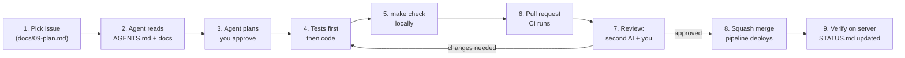

# 08 — AI-driven software development life cycle

This page explains how you and an AI coding agent build this project together. It works the same way with Claude Code, GitHub Copilot and Codex.

## 1. Roles

| You (human) | AI agent |
|---|---|
| Product owner: decide what is built and in which order | Reads the specification and proposes a plan |
| Reviewer: read every diff, test in the browser, approve or reject | Writes tests and code, runs the checks, opens the PR |
| Operator: own all secrets, keys and settings | Never sees secrets; asks you to do those steps |
| Accountable: you answer for every line that is merged | Explains what it did and why |

"The AI wrote it" is not an excuse. If you cannot explain a change, do not merge it.

## 2. Principles

1. **Specification first.** The documents in `docs/` say what to build. The agent reads them; you do not retype them in prompts. When behaviour changes, change the document in the same PR.
2. **Small steps.** One issue, one branch, one PR, under about 400 changed lines. Small PRs are easy to review and easy to revert.
3. **Tests are the contract.** Acceptance criteria become tests before code. A green pipeline is the proof, not the agent's summary.
4. **Plan, then act.** The agent states its plan first. You correct the plan, which is cheap. Correcting code is expensive.
5. **Verify, do not trust.** Run it. Open the page. Read the test. Agents can report success when something failed.
6. **Fresh eyes for review.** Review with a different tool or a new session than the one that wrote the code. A session tends to agree with its own work.
7. **Deploy from day one.** The pipeline exists before the features. Every merged PR is live minutes later.
8. **Keep context clean.** One task per session. Start a new session for the next task. Long sessions drift and forget rules.
9. **Shared memory is in the repository.** `AGENTS.md`, `docs/` and `docs/STATUS.md` carry knowledge between sessions and between tools. Chat history does not.
10. **Guardrails are automatic.** Rulesets, required checks, the test database guard and secret scanning stop mistakes even when you and the agent both miss them.

## 3. The loop for one task

| Step | What happens | Prompt ([prompts.md](prompts.md) Part A) | Who |
|---|---|---|---|
| 1 | Choose the next open task of the current phase. Tasks are GitHub issues created from `docs/09-plan.md`. | — | You |
| 2–3 | Start a **new** agent session. The agent reads the rules and the documents and gives a plan: files, tests, questions. You answer and approve. | **1 Plan** | Both |
| 4 | The agent creates a branch and writes failing tests from the acceptance criteria. You read the tests. Then the agent writes the code. | **2 Tests first**, **3 Implement** | Agent, you check |
| 5 | The agent runs `make check` (and `make e2e` when a user journey changed) until green. | **3 Implement** | Agent |
| 6 | The agent cleans its diff, updates the documents, pushes and opens a PR with the template. CI runs. | **4 Pull request** | Agent |
| 7 | A second tool or a fresh session reviews the PR. You read the findings and the diff (tests first), and decide what to fix. The agent fixes. | **5 Review**, **6 Fix findings** | Both |
| 8 | Squash-merge. The pipeline builds, tests and deploys. | — | You |
| 9 | The agent watches the pipeline and checks the version. You open `http://spm.iotserver.uz:<PORT>` and use the feature. Close the issue. | **7 Verify deployment** | Both |

Then the loop starts again with the next task. A phase is 5 to 8 such loops. The whole project is about 35.

Use the prompts in order. Do not join them into one prompt such as "implement issue 14": each prompt ends at a checkpoint where you decide. Without the checkpoints you only find out at the end that the plan was wrong.

## 4. How each tool finds the rules

| Tool | File it reads automatically | What that file contains |
|---|---|---|
| Codex (CLI, IDE, cloud) | `AGENTS.md` | The rules |
| GitHub Copilot (agent mode, coding agent, code review) | `.github/copilot-instructions.md`, and `AGENTS.md` | A pointer to `AGENTS.md` |
| Claude Code | `CLAUDE.md` | `@AGENTS.md` import |
| Other tools (Cursor, Gemini CLI, …) | Most read `AGENTS.md` | The rules |

There is exactly one place for rules: `AGENTS.md`. If you add a rule, add it there. Sub-folders get their own short `AGENTS.md` in Phase 1 (`backend/AGENTS.md`, `frontend/AGENTS.md`) for conventions that apply only there.

Keep `AGENTS.md` short. Agents load it in every session. Long rule files are followed less well. Details belong in `docs/`.

## 5. Good prompts

A good task prompt has four parts:

1. **Goal**: the issue number or story ID. ("Implement issue #14, story FR-06.")
2. **Context pointer**: which documents apply. ("Read AGENTS.md, docs/04-api.md section Posts, docs/03-data-model.md.")
3. **Constraints**: what must not change. ("Do not change the API contract. No new dependencies.")
4. **Done means**: how you will check. ("Tests named after each AC pass, `make check` is green, PR opened.")

Ready prompts are in [prompts.md](prompts.md): the task cycle (Part A), the prompts for each phase (Part B) and the prompts for problems (Part C). Copy them; change only the values in `<...>`.

Bad prompts: "build the backend", "fix it", "make it better". They give the agent no test for done.

## 6. Reviewing AI-written code

Look for these typical problems:

| Problem | How to spot it |
|---|---|
| Works for the happy path only | Are there tests for errors, empty lists, wrong owner, not logged in? |
| Tests that test nothing | A test with no assertion, or one that asserts a mock. Break the code on purpose: does a test fail? |
| Invented API | An endpoint, field or config variable that is not in `docs/`. |
| Invented or unneeded dependency | New lines in `pyproject.toml` or `package.json`. Check the package on PyPI or npm yourself. |
| Check weakened | Deleted or skipped test, lower coverage limit, `# noqa`, `eslint-disable`, `continue-on-error`. |
| Scope creep | Files changed that the task did not need. "While I was here" refactoring. |
| Security shortcuts | Missing ownership check, SQL built from strings, secrets in code, CSRF exemption. |
| Duplicate code | A helper that already exists was written again. |
| Stale documents | Behaviour changed but `docs/` did not. |

## 7. When the agent is stuck or wrong

- **Same error three times:** stop the session. Start a new one. Describe the error, what was tried, and ask for causes before fixes.
- **Agent says "done" but checks fail:** paste the failing output. Ask it to find the root cause, not to change the test.
- **Agent wants to change the specification:** that can be right. Decide yourself, record it in `docs/10-decisions.md`, then let it continue.
- **Agent wants to disable a check:** the answer is no unless you understand and agree. Write the reason in the PR.
- **Large change needed:** ask the agent to split it into several issues first.

## 8. Using more than one agent

- One agent writes, another reviews. This is the most useful combination.
- Do not let two agents edit the same branch at the same time.
- Cloud agents (Copilot coding agent, Codex cloud, Claude Code on the web) can take an issue and open a PR by themselves. The same rules apply: one issue, tests, PR template, your review. They run in a sandbox without your secrets; that is intended.

## 9. What to record

Each PR records the AI help in the template: which tool, what it did, what you checked or changed by hand. This is honest engineering practice and it is course evidence. Keep it short and true.

## 10. Learning goal

At the end you can answer, for your own project:

- What does each container do and how do they talk?
- What happens between `git push` and the new version on the server?
- Where is the data, and why can a test or a deployment not destroy it?
- Which checks protect `main`, and what would happen without each of them?
- Which mistakes did the AI make, and which check or review caught them?
